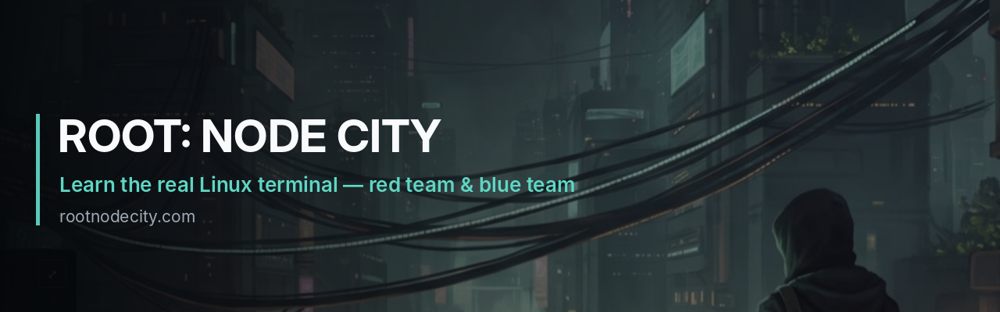
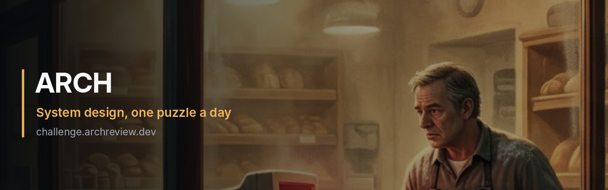

# Anton Dolganin

**Senior Backend Engineer — Go & Java** · Distributed systems, cloud-native

15+ years in production backend development, the last five on Go with Java/Spring Boot alongside it. I build high-load distributed systems: event-driven architectures on Kafka, gRPC services, and stateful workloads on Kubernetes. Currently own core services of a loyalty platform serving 10M+ active users at thousands of TPS, running at 99.99% availability.

Hands-on by choice — I write production code daily and own services end to end: data model, API design, rollout, on-call.

## Open to work

Remote-first, based in Spain (CET). I hold the Spanish international teleworking permit: employment is possible with companies established **outside** Spain, or on a B2B contract as a registered autónomo. No visa sponsorship required.

Backend, platform and infrastructure roles.

## How I build

AI isn't a threat to my craft — it's the strongest tool I've worked with, and I use it heavily, every day. Agentic workflows, not autocomplete. The agent writes the code; I keep the design, the architecture, the product decisions and the release. Control doesn't move: I decide what gets built and what ships, and I'm accountable when it breaks. It's how I run two products alongside a full-time job.

## Projects

A browser game that teaches the real Linux terminal and the traces it leaves. **Blue team:** dig answers out of logs, file ownership and timestamps. **Red team:** work jobs on remote hosts under a detection timer, where covering your tracks is part of the job.

TypeScript end to end — a server-side shell with a per-player virtual file system, pipes, redirects, globs and man pages, streamed over WebSocket; Node.js and PostgreSQL behind it. Progress is validated by the state you produce, not by matching an expected string.

Launching on web and Steam.

Each level is a small business with a nasty problem: a bakery whose site dies every Saturday at 8:00, a customer charged three times. Drag the parts onto the board, open the shop, and the morning plays out — the system holds or it doesn't. More than one right answer, and every component the problem never asked for costs you.

Behind the game sits [a design canvas](https://archreview.dev/) where an LLM reads your architecture against the requirements, scores it on five axes, and pins what's missing to the components it's missing from.

## Things I've built at work

- A custom Kubernetes predictive auto-scaling controller (Go, Operator SDK) that reads leading metrics to pre-warm heavy JVM services ahead of traffic spikes, eliminating cold-start failures during peak campaigns.
- A greenfield suite of distributed Go and Java microservices replacing a legacy monolith, with Kafka event-driven communication and strict consistency guarantees across service boundaries.
- Replaced a 120 GB in-memory Apache Ignite cluster with a single optimised PostgreSQL table at 8 GB, validated under production-like load.
- The real-time Kanban backend at Bitrix24: concurrent board updates, conflict resolution and live sync across multiple simultaneous clients.

Most of my production work lives in private repositories.

## Stack

**Languages** — Go, Java / Spring Boot · TypeScript / Node.js · Python (tooling, automation) · Rust, C (internal tools)

**Infrastructure** — Kubernetes (Operator SDK, CRDs, client-go), Docker, AWS, Linux, Nginx, Jenkins, GitHub Actions

**Data & messaging** — Apache Kafka, PostgreSQL, ClickHouse, Redis, Elasticsearch, Apache Ignite

**Observability** — Prometheus, Grafana, OpenTelemetry

**Practices** — Microservices, event-driven design, CQRS, DDD, REST and gRPC / Protobuf APIs, high availability & disaster recovery, on-call ownership

## Contact

- [d-it.ru](https://d-it.ru/en/contact)
- [linkedin.com/in/antonds](https://www.linkedin.com/in/antonds/)
